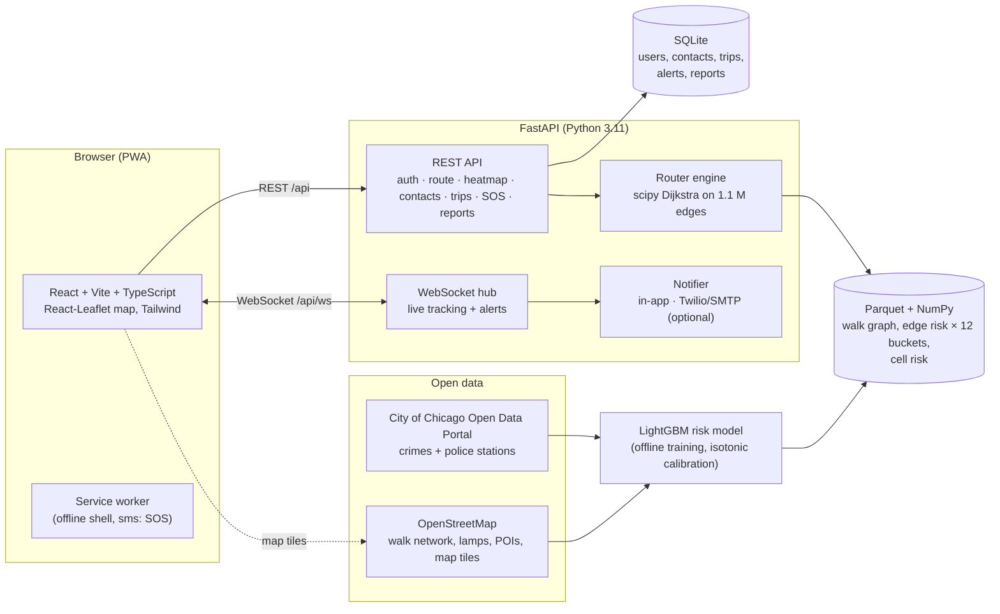

# WAYRA – SafeRoute

*Navigate Safely, Live Fearlessly.* A women-safety navigation web app that finds the **safest** walking route, not just the fastest, and keeps trusted people in the loop while you walk.

**Pilot: Chicago (data-available city).** Chicago is the city with open, street-level crime data we could train on; the Indian cities from the pitch are future work. Full project spec: [CLAUDE.md](CLAUDE.md). Presenter script: [DEMO.md](DEMO.md).

## Summary

WAYRA scores every street in Chicago for each 2-hour window of the day with a LightGBM risk model trained on City of Chicago crime reports (2022 onwards) plus OpenStreetMap lighting and activity proxies. For any walk it offers three routes (**Safest**, **Balanced**, **Fastest**), colours each street green / amber / red, and says how much risk you avoid compared with the fastest way (for example "−39% risk vs Fastest, +13 min"). During a trip, trusted contacts follow you live on a private link with no app install. Deviation alerts, a one-tap SOS, voice SOS, a fake call and an offline SMS fallback cover the moments when something goes wrong. A **demo mode** walker lets the whole flow be presented from anywhere.

## Quick start (demo)

```powershell
npm install; npm run setup     # once: Python venv, npm deps, .env
npm run seed:demo              # demo@wayra.app / Wayra@123 + contacts "Mom" and "Priya – friend"
npm run demo                   # builds the PWA and serves app + API on http://localhost:8080
```

`npm run demo` prints the app URL, the demo login and both watch links. The data files (`data/`, gitignored) must exist: see [Data pipeline](#data-pipeline).

## Features

| # | Feature | Status |
|---|---|---|
| 1 | Safest / Balanced / Fastest route comparison, with risk vs Fastest ("−39% risk") on every card | ✅ Live in pilot |
| 2 | AI safety score per street and per route (model card with held-out metrics) | ✅ Live in pilot |
| 3 | Colour-coded route (green / amber / red) with legend, zoom to street level (19), **Fit route**, collapsible panel | ✅ Live in pilot |
| 4 | Turn-by-turn **Directions**: street names from OSM with distance and risk per street; tap to zoom | ✅ Live in pilot |
| 5 | Night-safe mode (auto after Chicago sunset; extra weight on risk and unlit streets) | ✅ Live in pilot |
| 6 | Risk heatmap with a 2-hour time slider and "Next 2 hours" | ✅ Live in pilot |
| 7 | Live trip sharing over WebSocket: private watch links for contacts, one-off trip links | ✅ Live in pilot |
| 8 | Deviation alerts (off route > 100 m for 30 s, stopped 3 min, arrived safely) with an "Are you OK?" check-in first | ✅ Live in pilot |
| 9 | One-tap SOS with 5 s cancel, delivery log, `tel:911` button (never auto-dials) | ✅ Live in pilot (delivery to contacts is in-app; authorities are simulated) |
| 10 | Voice SOS ("help help" / "WAYRA help") | ✅ Chrome / Edge only |
| 11 | Fake incoming call | ✅ Live in pilot |
| 12 | Offline SOS: installable PWA, `sms:` fallback with the last known location | ✅ Live in pilot |
| 13 | Incident reports that raise nearby street risk for 2 h and re-route active trips | ✅ Live in pilot |
| 14 | Trusted contacts (up to 5), JWT accounts | ✅ Live in pilot |
| 15 | Demo mode: simulated walker, deviation/stop buttons; switches on by itself outside Chicago or without GPS permission | ✅ Live in pilot |
| – | Real SMS / email delivery (Twilio, SMTP) | 🧪 Stubs behind env vars, not tested against live services |
| – | Indian cities | 🔜 Future work (needs a street-level incident dataset) |

## Architecture



The ML pipeline (`ml/01–05`) runs offline: download → clean → features → LightGBM → per-street risk. The backend only loads its outputs (Parquet/NumPy, ~3 s at startup) and answers a 3-route request in ~0.1–0.2 s.

## Measured results

Model, on held-out test months (2026-01 to 2026-10, never seen in training or calibration), from [ml/reports/metrics.json](ml/reports/metrics.json):

| Metric | LightGBM model | Baseline (previous 12-month frequency) |
|---|---|---|
| ROC-AUC | **0.838** | 0.719 |
| PR-AUC | **0.178** | 0.123 (positive rate 3.0 %) |
| Hit rate @ top 10 % of cells | **47.2 %** | 40.0 % |

Routes on the real Chicago graph (length-weighted mean relative risk vs Fastest; scores are 0–100, relative to all streets at all hours):

| Trip | Time | Fastest score | Balanced | Safest |
|---|---|---|---|---|
| Union Station → Navy Pier | 14:00 | 9 | 25 (−17 % risk, +4 min) | 28 (−21 % risk, +5 min) |
| | 23:00 | 10 | 25 (−17 %, +4 min) | 30 (−22 %, +6 min) |
| UChicago → 63rd St Green Line | 14:00 | 21 | 33 (−15 %, +0 min) | 34 (−16 %, +0 min) |
| | 23:00 | 25 | 36 (−15 %, +0 min) | 37 (−16 %, +1 min) |
| Wrigley Field → Lincoln Park Zoo | 14:00 | 16 | 41 (−30 %, +8 min) | 49 (−39 %, +13 min) |
| | 23:00 | 19 | 28 (−10 %, +2 min) | 50 (−38 %, +16 min) |

Scores look low because they compare each route with every street in the city at every hour, and the Loop ranks as busy and incident-heavy. That is why the cards lead with the comparison against Fastest.

## Tech stack

| Layer | Choice |
|---|---|
| Frontend | React 19, Vite, TypeScript (strict), Tailwind CSS v4, React-Leaflet + OSM tiles, lucide-react, `motion`, vite-plugin-pwa |
| Backend | Python 3.11, FastAPI, SQLAlchemy, SQLite (Postgres-ready via `DATABASE_URL`), WebSockets, JWT (PyJWT + bcrypt) |
| Routing | NumPy / SciPy (sparse Dijkstra, cKDTree), Parquet caches of the OSMnx walk graph |
| Data / ML | pandas, pyarrow, h3 (res-9 hexagons), osmnx, LightGBM, scikit-learn (isotonic calibration), astral (sunset) |
| Tooling | npm scripts + PowerShell (Windows), pytest, Playwright (E2E, outside the repo) |

## How to run

| Command | What it does |
|---|---|
| `npm install && npm run setup` | One-time setup (Python 3.11 venv, deps, `.env` with a random `JWT_SECRET`) |
| `npm run data` → `npm run train` → `npm run score` | Build the data: download + clean, train the model, score every street (first run ~10 min) |
| `npm run seed:demo` | Create or reset the demo account and print the watch links (safe to rerun; links stay the same) |
| `npm run demo` | Production build (PWA) + backend on **http://localhost:8080** (app and API on one port) |
| `npm run dev` | Development: backend on :8000 with reload + Vite on :5173 |
| `npm test` | Backend + ML pytest and the frontend typecheck |

On start the backend prints a checklist (walk graph, edge risk, model card, heatmap, database, frontend build) and warns about anything missing; the affected features are disabled with a clear message instead of crashing.

## Limitations

- **Chicago only.** The model needs a street-level incident dataset; Chicago publishes one, Indian cities don't (yet).
- **Historical, relative risk.** Scores rank streets against the rest of the city from past reports. They are not a guarantee for any single walk, and under-reported crime is invisible to the model.
- **Lighting and crowds are estimates** from OpenStreetMap (lamps, `lit` tags, road class, points of interest). Only ~3 % of Chicago's edges have lighting data; there is no live feed.
- **Messaging is simulated by default.** Contacts get alerts on their watch page; SMS/email notifiers are untested stubs; the 911 entry is a log line plus a `tel:` button.
- **Single process.** The live hub is in-memory (one server); a restart drops trails and pending check-ins.
- **Map tiles need internet.** The app shell and offline SOS work offline, the street map background doesn't.
- **Directions** are street names along the route (unnamed sidewalks take the name of the street they run beside), not spoken turn-by-turn navigation.

## Future work

- **Indian cities** (Delhi, Bengaluru, Mumbai) with local incident sources, crowd-sourced reports and city-specific lighting data.
- **Real SMS / WhatsApp delivery** (Twilio or an Indian SMS gateway) with delivery receipts.
- **Managed auth** (e.g. Cognito / Entra ID / Auth0) with phone OTP.
- **Cloud deployment on AWS or Azure** with **PostgreSQL** (+ PostGIS), Redis pub/sub for the live hub, HTTPS, and a scheduled retraining job.
- Live signals: transit crowding, open businesses, verified lighting surveys; spoken turn-by-turn guidance.

---

# Reference

## Features in detail

- **Landing page (`/`, public):** sticky glass navbar with a mobile menu (Features · How it works · AI Model · Safety Tools; "Log in" + "Sign up", or "Open App" when signed in). Hero with an animated app mock (SVG city grid, red fastest vs glowing green safest path). Problem stats from the pitch research (labelled as such), feature grid with honest status tags, a 3-step "How it works", **live model metrics** as animated counters from the public `GET /api/public/model-summary`, "Who it's for", CTA band and footer.
- **Design system:** Bricolage Grotesque (headings) + Plus Jakarta Sans (body), bundled with `@fontsource-variable` so they work offline. Purple/teal tokens in `frontend/src/index.css` (`@theme`: `brand-50…950`, `ink`, `canvas`, `line`, shadows). Green/amber/red are reserved for safety meaning. `lucide-react` icons, `motion` animations (scroll reveals, hover lifts, press states), all off under `prefers-reduced-motion`.
- **Routes:** `/` landing · `/login`, `/register` (signed-in users go to `/app`) · `/app` map (sign-in required) · `/model` model card (sign-in required; `/model-card` redirects) · `/contacts` trusted contacts · `/sos` SOS history · `/watch/:token` a contact's private watch page (public, token-protected) · `/track/:token` a one-off trip link (public). After login you land on `/app`, or on the page you were sent from. The signed-in user is cached, so an offline reload still opens the app and the offline SOS.
- **Auth pages:** split screen with a gradient brand panel (logo, tagline, trust points) and a form card with icons in the inputs, show/hide password, a password-strength hint on register, a submit spinner, friendly errors, links between the two pages and "← Back to home".
- **App navbar:** logo, Map · Contacts · AI Model (icons on phones), an **Offline** badge when the browser loses its connection, a **Listening** pill while Voice SOS is on, and an avatar menu with Trusted contacts, SOS history, Fake call, the Voice SOS switch and Log out.
- **Accounts:** register, sign in and log out (JWT). Users live in SQLite (`backend/wayra.db`, gitignored) with bcrypt-hashed passwords. The map and model card need sign-in.
- **Search panel:** From/To with Chicago-only autocomplete (Nominatim through a backend proxy, 1 req/s, cached), "Use my location", a departure-time picker ("Now" by default, or a Chicago-time date/time), and a **Night-safe** control (Auto / On / Off). A **🌙 Night-safe mode active** badge appears automatically after Chicago sunset (from `GET /api/status`) or when switched on. Changing the time or night setting re-plans the shown route. Once routes arrive the form folds into a "From → To · Edit" line; the **«** button hides the whole panel so the map gets the full width (**Show routes** brings it back).
- **Quick-demo chips:** "Union Station → Navy Pier", "UChicago → 63rd St Green Line" and "Wrigley Field → Lincoln Park Zoo" fill From/To and search at once.
- **Route comparison:** three cards (Safest, Balanced, Fastest), each with a colour-coded safety score badge, ETA, distance, a green/amber/red proportion bar, the **risk vs Fastest** ("−39% risk", from the length-weighted mean relative risk) and the extra minutes. Safest is labelled **Recommended** and selected by default. Select a route by clicking a card, with the arrow keys (radio group), or by clicking its grey line on the map. A summary under the cards repeats it in words ("1.6× less risk than Fastest (−38%) · +16 min" for Wrigley Field → Lincoln Park Zoo at night) and explains why night scores are lower.
- **Start trip:** a large button pinned to the bottom of the panel, labelled with the selected route ("Start trip on Safest route"), always visible however far the list scrolls. With real GPS, a short explainer (why location is needed, shared only during the trip or an SOS) comes before the browser's permission prompt.
- **Directions:** the selected route as a list of streets (OSM names; consecutive edges on the same street merge, crossings under 30 m fold into the street before them; unnamed sidewalks take the name of the street within 25 m), each with its distance and a risk colour. Tapping a row zooms the map to that street and highlights it.
- **Colour-coded map:** the selected route is drawn with a dark halo, a white casing and green / amber / red segments on top, so it reads at every zoom (up to 19) and over any map colour; the alternatives are grey dotted lines. Large A/B pins with a white border and outline. The map fits the route clear of the panel; **Fit route** refits. If the OSM tiles can't load, a notice says the map background needs internet (routes, SOS and alerts keep working).
- **Risk heatmap:** a toggle shows the ~6k model hexagons coloured by relative risk. A slider covers the 12 two-hour windows (labelled like "10 PM–12 AM"), a **Next 2 hours** button jumps to the upcoming window, and a legend is included. Hexagons are drawn on canvas and don't capture clicks, so the map still pans.
- **Model card page** (header nav): the data and model in plain words, the real model-vs-baseline test metrics from `GET /api/model-card`, a feature-importance chart, and the limitations.

## Safety features in detail

**How alerts reach people without SMS accounts.** Trusted contacts are not app users. Each contact gets a personal secret **watch link** (`/watch/:token`, 128-bit token). That page needs no login and shows, live over a WebSocket: the current trip on a map (moving marker, planned route, walked trail), trip status (ETA, distance left, on/off route, "Checking in with Asha…"), and an alert feed. An SOS turns the page into a big red banner with a siren sound and a browser notification (after the contact taps **Turn on alerts**, which unlocks audio and asks for notification permission). Every alert goes through the backend `Notifier` interface: `InAppNotifier` (the watch page; delivered "live" if it's open, otherwise "queued" in its feed) is always on, and `TwilioNotifier` (SMS) / `EmailNotifier` switch on only when their env vars are set. Those two are minimal stubs that haven't been run against the live services.

- **Trusted contacts (`/contacts`):** add / edit / delete (name, relation, phone, email; a phone or an email is required), up to **5**. Each card has **Copy watch link**, **WhatsApp** and **SMS** (`wa.me` / `sms:` links pre-filled with an invite and the watch link), Email, **Preview their page**, and **Reset watch link** (the old link stops working).
- **Trips + live tracking:** **Start trip** (pinned to the bottom of the route panel) creates a trip and streams your location over `/api/ws/user` (real GPS via `watchPosition` every 3 s, or the demo walker every 1 s) to the contacts' watch pages. The trip panel shows ETA, distance left, progress, on/off route, **I'm safe** (a reassurance message to everyone), **End trip**, **Trip link** (copies `/track/:token` for people who aren't saved contacts), Fake call, Report and the Voice SOS switch. A trip survives page reloads and moving between pages.
- **Deviation detection** (`backend/app/services/deviation.py`): more than **100 m off the route for over 30 s**, or **stationary (within 25 m) for over 3 min** mid-trip, starts a check-in. Your phone shows **"Are you OK? Alerting your contacts in 15 s"** (with I'm OK and Send SOS); if nobody answers, the contacts get an off-route / stopped alert. Answering snoozes that reason until the condition clears or 2 min pass. Reaching **within 40 m of the destination** sends "arrived safely" and ends the trip. GPS accuracy counts in your favour, capped at 50 m. The 15 s deadline is enforced on the server by a 1 s ticker, so it fires even if the app goes quiet.
- **DEMO MODE:** a switch in the trip panel (and a checkbox next to Start trip, on by default) replaces GPS with a simulated walker that follows the route at **1× / 5× / 20×** (5 km/h × speed). **Simulate deviation** walks it 200 m off the route (and **Back on route**), **Simulate stop** freezes it. Demo trips use shorter timers (off route 10 s, stopped 20 s; the 15 s check-in stays) and are labelled **DEMO MODE** in the app and **Demo** on the watch page. If you start a trip with real GPS from outside Chicago (or location is denied, or there is no fix), the app switches to demo mode on its own: a toast plus an amber note at the top of the trip panel say why.
- **SOS:** the floating SOS button opens a full-screen **5-second countdown** with a big Cancel (Esc works too), then sends the SOS with your location to all contacts, keeps streaming your location, and shows **"Help is being alerted"** with the delivery list, a **Call 911** `tel:` link (Chicago pilot) and **I'm safe now** to resolve. It can be minimised to a red bar. WAYRA never dials anyone; the "Authorities (911)" entry in the log is marked *simulated*. **SOS history** (`/sos`) lists every SOS with time, trigger (button / voice / offline), location, duration and per-contact delivery status, plus the other messages your contacts got.
- **Voice SOS:** switch it on in the avatar menu or the trip panel. The Web Speech API listens continuously for **"help help"** or **"WAYRA help"** (plus common mishearings of "WAYRA") and starts the SOS countdown. A "Listening" pill shows in the navbar; unsupported browsers get a clear message (works in Chrome and Edge).
- **Fake call:** avatar menu or trip panel → pick a caller (Mom, Dad, Sister, Priya or custom) and a delay (now / 10 s / 30 s) → a full-screen incoming-call screen that looks like a phone (avatar, ringing rings, a ringtone generated with Web Audio, vibration where supported). Accept shows an in-call screen with a timer; Decline/End closes it.
- **Offline emergency + PWA:** `vite-plugin-pwa` makes the app installable and precaches the app shell (HTML/JS/CSS/fonts/icons). If `navigator.onLine` is false when the SOS countdown ends (or the server can't be reached), the app opens an `sms:` link to all contacts' phone numbers pre-filled with **"SOS from WAYRA – my location: https://www.openstreetmap.org/?mlat=..&mlon=.."** using the last known position (kept in `localStorage`, as is the contact list).
- **Incident reports:** **Report** (map button, or the trip panel during a trip) → category + optional note at a map point. Streets within 150 m get up to +0.6 relative risk, fading linearly to zero over 2 h, so new routes avoid them and their colours/scores reflect it. Reports show on the map as amber circles fading with age. During a trip the app re-checks every 60 s (first after 8 s): if a fresh report lies ahead on your route and a re-plan avoids it, a **"Safer route found"** card offers **Switch route**; contacts see the new route too.
- **Friendly errors:** "outside the Chicago pilot area", "no walking route found", "still getting ready" (data not loaded: run `npm run score` / `npm run train`), "can't reach WAYRA" (backend down), and "feature not available yet" (an old backend). The app never shows a bare "Not Found". A banner appears when the server reports routing data isn't loaded.

## Configuration

`.env` (created by `npm run setup` from [.env.example](.env.example)):

| Variable | Purpose |
|---|---|
| `JWT_SECRET` | Key that signs login tokens. `setup` generates a random one. If you create `.env` by hand, set a long random string: `python -c "import secrets; print(secrets.token_urlsafe(48))"` |
| `JWT_EXPIRE_MINUTES` | Token lifetime (default 1440 = 24 h) |
| `DATABASE_URL` | Defaults to SQLite `sqlite:///./wayra.db`, relative to `backend/` |
| `NOMINATIM_USER_AGENT` | User-Agent sent to Nominatim. Add contact details before deploying publicly. |
| `PUBLIC_BASE_URL` | Web app URL used in links sent by SMS/email (default `http://localhost:5173`; `npm run demo` sets `http://localhost:8080`) |
| `SERVE_FRONTEND` | `true` makes the backend serve `frontend/dist` (set by `npm run demo`) |
| `TWILIO_ACCOUNT_SID`, `TWILIO_AUTH_TOKEN`, `TWILIO_FROM_NUMBER` | Optional. All three set → urgent alerts (SOS, off route, stopped, arrived, I'm safe) are also sent by SMS. Untested stub. |
| `SMTP_HOST`, `SMTP_PORT`, `SMTP_USER`, `SMTP_PASSWORD`, `EMAIL_FROM` | Optional. Host + sender set → the same alerts are also emailed. Untested stub. |
| `SOCRATA_APP_TOKEN` | Optional. A free [City of Chicago app token](https://data.cityofchicago.org/profile/edit/developer_settings) raises the API rate limit for `npm run data`. |

## Prerequisites (Windows)

| Tool | Version | Install |
|---|---|---|
| Python | **3.11** (official python.org build) | `winget install -e --id Python.Python.3.11 --scope user` |
| Node.js | 20+ (tested on 22) | `winget install -e --id OpenJS.NodeJS.LTS` |
| Git | any recent | `winget install -e --id Git.Git` |

> ⚠️ Use the official CPython from python.org/winget. MSYS2/MinGW Python (e.g. `C:\msys64\ucrt64\bin\python.exe`) cannot install the pandas, pyarrow, lightgbm or h3 wheels.

## Setup

From the repo root in PowerShell:

```powershell
npm install        # installs concurrently (root dev tool)
npm run setup      # creates backend\.venv, installs Python + frontend deps, copies .env.example -> .env
```

`npm run setup` runs [scripts/setup.ps1](scripts/setup.ps1). To do it by hand instead:

```powershell
# Python 3.11 venv for the backend
& "$env:LOCALAPPDATA\Programs\Python\Python311\python.exe" -m venv backend\.venv
backend\.venv\Scripts\python.exe -m pip install -r backend\requirements.txt

# Frontend
npm --prefix frontend install

# Environment
Copy-Item .env.example .env
```

## Run

```powershell
npm run dev            # backend (http://localhost:8000) + frontend (http://localhost:5173) together
npm run dev:backend    # FastAPI only, with auto-reload
npm run dev:frontend   # Vite only
```

Open http://localhost:5173 to see the landing page. Create an account (Sign up) to reach the map at `/app`. The Vite dev server proxies `/api/*` to the backend, so these should both return `{"status":"ok"}`:

```powershell
Invoke-RestMethod http://localhost:8000/api/health
Invoke-RestMethod http://localhost:5173/api/health
```

API docs: http://localhost:8000/docs

## Data pipeline

```powershell
npm run data                        # download + clean (same as npm run ml:data)
npm run data:download               # step 1 only; skips files that already exist
npm run data:download -- --force    # re-download everything
npm run data:download -- --only osm # just one step: crimes | stations | osm
npm run data:clean                  # step 2 only
```

Settings (date range, crime types, public location list, severity weights, bounding box, H3 resolution) live in [ml/config.yaml](ml/config.yaml).

| Step | Output (in `data/`, gitignored) |
|---|---|
| [ml/01_download.py](ml/01_download.py) | `raw/crimes.csv`: City of Chicago "Crimes – 2001 to Present" (Socrata `ijzp-q8t2`) since 2022-01-01, filtered on the server to the relevant crime types and `domestic = false`. It is fetched in pages of 50,000 with retries, and an interrupted download resumes from the last finished page. |
| | `raw/police_stations.csv`: police stations (Socrata `z8bn-74gv`) |
| | `raw/osm_pois.parquet`: OSM shops, restaurants, cafes, bars, transit stops/stations and hospitals in the City of Chicago (as points, with a `category`). `raw/osm_lamps.parquet`: OSM `highway=street_lamp` |
| [ml/02_clean.py](ml/02_clean.py) | `processed/incidents.parquet`: keeps theft only when it is from a person (pocket-picking, purse-snatching) and keeps only public locations. Drops rows without coordinates or outside the Chicago bounding box. Adds `severity`, `hour`, `weekday` (Mon = 0), `month`, `after_dark` (astral sunset/sunrise for Chicago) and `h3` (resolution 9). Prints a summary. |

The first full run takes several minutes; most of that is the crime download and the OSM Overpass queries.

## Risk model and street safety scores

```powershell
npm run train    # 03_features.py + 04_train.py (~1.5 min)
npm run score    # 05_score_edges.py; first run ~4 min (downloads the walk graph, parses it in ~25 s), reruns <1 min
```

| Step | Output |
|---|---|
| [ml/03_features.py](ml/03_features.py) | `data/processed/panel.parquet`: one row per (H3 res-9 cell, month, 2-hour bucket) with lagged counts and severity sums (1/3/12 months) for the cell and its neighbours, cell totals, month-of-year and after-dark share. `cells.parquet`: per-cell street-lamp, POI and night-POI counts and distance to the nearest police station |
| [ml/04_train.py](ml/04_train.py) | LightGBM with early stopping, isotonic calibration on the validation months. `data/models/risk_model.joblib`, `data/processed/cell_risk.parquet` (risk 0–1 per cell × 12 buckets for the next month), [ml/reports/metrics.json](ml/reports/metrics.json) and [ml/reports/feature_importance.png](ml/reports/feature_importance.png) |
| [ml/05_score_edges.py](ml/05_score_edges.py) | `data/graph/chicago_walk.graphml`, plus the caches the backend loads (`walk_edges.parquet` incl. OSM street `name`, `walk_nodes.parquet`, `walk_geom.npz`; the backend adds `walk_labels.npz`, the directions label per edge, on first start). `data/processed/edge_risk.npy` (raw risk, edges × 12, float32), `edge_rel_risk.npy` (relative risk 0–1, same shape) and `edge_index.parquet` (row i = edge i: `u, v, key, length, unlit, …`) |

The split is temporal: train 2023-01 to 2025-06, validate 2025-07 to 2025-12, test 2026-01 onward. Test-set results (the latest run is in [metrics.json](ml/reports/metrics.json)):

| Metric | Model | Baseline (previous 12-month frequency) |
|---|---|---|
| ROC-AUC | 0.838 | 0.719 |
| PR-AUC | 0.178 | 0.123 |
| Hit rate @ top 10% of cells | 47.2% | 40.0% |

The street score starts from the risk of the cell containing the edge's midpoint, made slightly lower for busier streets (POIs within 100 m). Since Phase 5 the stored score has **no lighting penalty**: lighting data is too sparse for a flat night penalty to mean anything (92% of edges fall back to "unlit"). Lighting counts only inside the router's cost when night-safe mode is on (see [Routing](#routing)). An edge counts as lit if it has an OSM `lit=yes` tag or a mapped street lamp within 40 m. OSM has lighting data for only ~3% of Chicago's edges, so the rest fall back to road class: trunk/primary/secondary/tertiary roads count as lit, and residential streets, service roads/alleys, footways and paths count as unlit. Lighting and crowd levels are **estimates from OpenStreetMap**, not live data.

Calibrated risks are small probabilities, so the map and the router use **relative risk**: the percentile rank of each edge's risk, ranked across all edges and all 12 buckets together, so a street ranks as riskier in the windows where the model predicts more incidents. Colours: green < 0.33, amber < 0.66, red above that.

Latest run, 1.1 M directed edges (92% count as unlit; used only for night-safe routing):

| Buckets | Raw risk mean | Median | p99 | Green | Amber | Red |
|---|---|---|---|---|---|---|
| Day (06:00–20:00) | 0.035 | 0.019 | 0.225 | 32.5% | 32.2% | 35.3% |
| Night (20:00–06:00) | 0.033 | 0.017 | 0.237 | 33.6% | 34.2% | 32.2% |

The old flat night penalty pushed 73% of night streets to red (Phase 4). Without it, day and night shares are close to thirds. The model's raw risk is about the same by day and by night, and percentiles split the city evenly.

All parameters are in `ml/config.yaml` (`model`, `edges`).

## Routing

The backend builds the routing graph at startup from the parquet/npz files above (it never parses the graphml). That takes about 2–3 s for 327 k nodes and 1.1 M edges (the first start after `npm run score` adds ~8 s to label sidewalks with street names, then caches them). If the files are missing, the server still starts, logs a warning, and `/api/route` returns 503 with a message telling you to run `npm run score`.

- **Edge cost** = length × (1 + λ × relative risk for the departure's 2-hour bucket). λ = 0 for **Fastest**, 1.5 for **Balanced** (was 3; lowered in Phase 5 so it sits between the other two instead of copying Safest), 8 for **Safest**.
- **Night-safe mode** turns on automatically between sunset and sunrise in Chicago (astral). It multiplies λ by 1.5 and adds 0.2 to the relative risk of unlit edges, **in the routing cost only**, so Balanced and Safest prefer lit streets. The safety score and colours never include this penalty. Fastest is always the plain shortest path. Send `night_mode: true` or `false` to override, or `"auto"` (the default).
- **Safety score** = round(100 × (1 − length-weighted mean relative risk)), on the plain relative risk.
- Start and end snap to the nearest graph node (up to 1.5 km away; further returns 422). Each profile runs Dijkstra (scipy) on the area around the trip (the start/end box plus 2 km). A request takes about 0.1–0.2 s. Routes that come out identical are still returned, with `identical_to` filled in and `identical_routes: true`.

```http
POST /api/route
{"from": {"lat": 41.8786, "lng": -87.6403}, "to": {"lat": 41.8917, "lng": -87.6086},
 "depart_at": "2026-11-19T23:00:00", "night_mode": "auto"}
```

`depart_at` is optional (default: now). A time without a zone is read as Chicago local time.

`GET /api/public/model-summary` (public) returns only the headline test metrics (ROC-AUC, hit rate @ top 10%, PR-AUC, each with its baseline, plus the test months and cell count) for the landing page.

`GET /api/status[?at=…]` (public) returns Chicago time, the 2-hour bucket, the auto night-mode flag with sunrise/sunset, and `routing_ready` / `heatmap_ready` / `model_card_ready`. The UI uses it for the night-safe badge and the "not ready" banner.

`npm run verify:routes` runs the three demo trips at 14:00 and 23:00 on the real data (latest run, 2026-11-19, λ = 0 / 1.5 / 8):

| Trip | Time | Route | Distance | ETA | Safety score |
|---|---|---|---|---|---|
| Union Station → Navy Pier | 14:00 | Fastest | 3.88 km | 47 min | 9 |
| | | Balanced | 4.20 km | 50 min | 25 |
| | | Safest | 4.31 km | 52 min | 28 |
| | 23:00 (night) | Fastest | 3.88 km | 47 min | 10 |
| | | Balanced | 4.20 km | 50 min | 25 |
| | | Safest | 4.40 km | 53 min | 30 |
| University of Chicago → 63rd St (Green Line) | 14:00 | Fastest | 2.31 km | 28 min | 21 |
| | | Balanced | 2.33 km | 28 min | 33 |
| | | Safest | 2.35 km | 28 min | 34 |
| | 23:00 (night) | Fastest | 2.31 km | 28 min | 25 |
| | | Balanced | 2.35 km | 28 min | 36 |
| | | Safest | 2.38 km | 29 min | 37 |
| Wrigley Field → Lincoln Park Zoo | 14:00 | Fastest | 3.87 km | 46 min | 16 |
| | | Balanced | 4.50 km | 54 min | 41 |
| | | Safest | 4.96 km | 60 min | 49 |
| | 23:00 (night) | Fastest | 3.87 km | 46 min | 19 |
| | | Balanced | 4.05 km | 49 min | 28 |
| | | Safest | 5.21 km | 63 min | 50 |

Safest beats Fastest on every trip (+12 to +33 points, for 2–35% more walking). Balanced now differs from Safest on all six runs. Scores are lower than in Phase 4 because the percentiles changed once the night penalty was removed: the Loop ranks high-risk relative to the rest of the city.

## Live safety API

All JSON, under `/api`. Signed-in endpoints use the bearer token; the watch/track endpoints are public and protected only by their unguessable token.

| Endpoint | What it does |
|---|---|
| `GET/POST /contacts`, `PUT/DELETE /contacts/{id}`, `POST /contacts/{id}/reset-link` | Trusted contacts (max 5 → 409) |
| `POST /trips` · `GET /trips/active` · `POST /trips/{id}/end` · `/safe` · `/ok` · `PATCH /trips/{id}/demo` · `POST /trips/{id}/reroute` · `POST /trips/{id}/recheck` | Trip lifecycle, "I'm safe", check-in answer (REST fallback), demo timers, switch route, 60 s safer-route check |
| `POST /sos` · `POST /sos/{id}/resolve` · `GET /sos` · `GET /alerts` | SOS (one open at a time), resolve, history with deliveries, your recent alerts |
| `POST /reports` · `GET /reports` | Incident reports (active ones with their current decay weight) |
| `GET /watch/{token}` · `GET /track/{token}` | Snapshot for a contact's watch page / a trip link |
| `WS /ws/user?token=<JWT>` | Your app: sends `{type:"loc",lat,lng,acc?,sim?}` and `{type:"ok"}`; receives `progress`, `check`, `check_cleared`, `alert`, `trip` |
| `WS /ws/watch/{token}` · `WS /ws/track/{token}` | Viewers: `snapshot` first, then `loc`, `trip`, `check`, `check_cleared`, `alert` |

Your location reaches watchers **only during a trip or an open SOS**. A contact's page shows only your first name. After a trip ends, its track link shows only that it ended.

## Using the map

1. Type a From and To in Chicago, or tap a demo chip (it searches immediately).
2. Optional: **Leave → Later** to pick a Chicago date/time, and **Night-safe → Auto / On / Off**.
3. Compare the cards. Tap a card or a grey line on the map to switch routes; the selected route shows green/amber/red segments.
4. **Heatmap** (button above SOS): drag the slider through the day or tap **Next 2 hours**.
5. **Model card** in the header explains the data, metrics and limitations.
6. Open **Directions** to see the streets; tap one to zoom to it. **Fit route** (right side) zooms back out.
7. **Start trip on … route** at the bottom of the panel (leave **Demo mode** ticked when you're not in Chicago). Add people in **Contacts** first and send them their watch links. See [DEMO.md](DEMO.md) for a full walkthrough.

## Test

```powershell
npm test               # backend pytest + ml pytest + frontend TypeScript typecheck
npm --prefix frontend run build   # production build (routes are code-split: Leaflet loads only on /app)
npm run test:backend   # auth, geocode, routing (+ street names), contacts, trips, SOS, notifiers, deviation, incidents, WebSockets, demo seed, startup check, static serving
npm run test:ml        # data cleaning, panel/lag, edge risk, lighting fallback, relative risk, graphml parser (no network)
npm run test:frontend
```

## Repo layout

```
backend/    FastAPI app (app/), pytest tests (tests/), requirements.txt, .venv (gitignored)
frontend/   React + Vite + TypeScript + Tailwind + React-Leaflet
ml/         data + model pipeline (config.yaml, 01_download … 05_score_edges, reports/, tests/)
data/       downloaded and processed data (gitignored)
scripts/    setup.ps1, demo.mjs (npm run demo), make_pwa_icons.py
backend/scripts/  verify_routes.py, seed_demo.py (npm run seed:demo)
```

## Troubleshooting

- **Voice SOS doesn't react**: use Chrome or Edge, allow the microphone, and stay online (Chrome's speech recognition runs on a server). Speak the phrase clearly: "help help" or "WAYRA help".
- **No sound or notification on the watch page**: tap **Turn on alerts** once; browsers block audio until you interact with the page.
- **The service worker / install prompt doesn't appear in `npm run dev`**: the PWA is only generated in production builds. Use `npm run demo` (http://localhost:8080) to test install and offline.
- **`npm run demo` says port 8080 is in use**: another `npm run demo` is still running. Close that window (Ctrl+C) and start again.
- **"Map tiles need internet"**: the OSM map background can't load. Everything else works; the tiles come back by themselves when the connection does.

- **`running scripts is disabled on this system`** when activating the venv: you don't need to activate it, because the npm scripts call `backend\.venv\Scripts\python.exe` directly. If you do want to activate it, run `Set-ExecutionPolicy -Scope CurrentUser RemoteSigned` once.
- **The map says "Still getting ready" or shows a banner**: the backend started without the routing or heatmap data. Run `npm run score` (and `npm run train` if `cell_risk.parquet` is missing), then restart the backend.
- **"Feature not available yet"**: the backend is an older build. Restart `npm run dev`.
- **"Use my location" says you're outside the pilot area**: routing only covers Chicago. Type a Chicago address instead.
- **Port already in use**: if Vite says `Port 5173 is in use, trying another one...`, an earlier `npm run dev` is probably still running. Close that terminal, or use the port Vite prints. Otherwise stop the other process on 8000/5173, or change `--port` in the root `package.json` and the proxy target in `frontend/vite.config.ts`.

## License

See [LICENSE](LICENSE).
